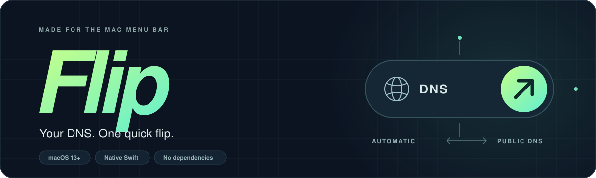

  

  <strong>A tiny macOS menu bar app that puts DNS switching one click away.</strong> 
  Your network's DNS when you want it. Public DNS when you need it.

  <a href="#get-started">Get started</a> ·
  <a href="#how-it-works">How it works</a> ·
  <a href="#for-coding-assistants">For coding assistants</a> ·
  <a href="#development">Development</a>

## A little switch for an everyday annoyance

Network-wide DNS adblocking is great—until it blocks the one thing you need.
Flip lets your Mac temporarily use public DNS, then return to the DNS supplied
by your network. No digging through System Settings or changing the router for
everyone else.

- **Automatic ↔ Public DNS.** Switch between your network's resolvers and Cloudflare.
- **Set it and come back.** Bypass for 5, 15, or 60 minutes, with a visible countdown.
- **A quiet menu bar.** One icon, small state badges, and no Dock icon.
- **Wi-Fi and Ethernet together.** Keep your enabled connections in step.
- **Stays in sync.** Detects external changes and checks again when the menu opens.
- **Assistant-friendly.** A local CLI with JSON results and bounded bypasses.
- **Native and small.** Swift, AppKit, and Apple frameworks. No third-party dependencies.

## Get started

Requires **macOS 13 or later** and **Swift 5.9 or later** through Xcode or the
Swift command line tools. Build the app locally:

~~~sh
git clone https://github.com/mobdevross/Flip-DNS.git
cd Flip-DNS
bash scripts/build-app.sh
open dist/Flip.app
~~~

For everyday use, move `dist/Flip.app` to **Applications**, open that copy, and
enable **Launch at Login** from the menu if desired. Keep it at a stable location.
Quit the running app before opening an updated build.

The build script signs the app for local use without a developer certificate.
It does not produce a notarized download for distribution to other Macs.

## How it works

| Menu choice | What happens |
| --- | --- |
| **Automatic** | Clears manual DNS server addresses so the network can supply them. |
| **Public DNS** | Sets Cloudflare's standard unfiltered DNS until you switch back. |
| **Public DNS for…** | Starts a 5-, 15-, or 60-minute bypass, then attempts to restore Automatic. |

Public DNS addresses

~~~text
1.1.1.1
1.0.0.1
2606:4700:4700::1111
2606:4700:4700::1001
~~~

The icon stays plain in Automatic mode. An **arrow** indicates manual DNS, a
**clock** indicates a timed bypass, and an **exclamation mark** indicates an
error or pending restoration. Hover or open the menu for the current mode.

Changes apply to enabled Wi-Fi and Ethernet services in the current macOS
network location, including disconnected adapters and USB tethering services
identified as Ethernet. Disabled, VPN, PPP, and bridge services are left alone.
Search domains and other network settings are preserved.

### Timers and permissions

Keep Flip running for timed restoration. Deadlines survive sleep and app relaunch;
an overdue timer is checked when the app resumes. A sleeping Mac restores after
waking.

**macOS may request administrator approval**, including when a timer expires.
If you decline or restoration fails, Flip shows **Restore pending**. Choose
**Restore Automatic Now…** to retry; public DNS can remain enabled until it succeeds.
There is no privileged background helper, and Flip never stores your password.

Restoration only clears addresses still matching the original bypass. DNS edits
made elsewhere are preserved. Quitting with a timer active offers to restore
first, keep the current settings and cancel the timer, or stay running.

Flip reports your Mac's configured DNS, rather than promising that adblocking is
on or off. Browser secure DNS, VPN resolvers, router interception, and application
caches can affect the result.

## For coding assistants

Give a coding agent a temporary DNS bypass without making it manage the timer.
Flip owns the same bypass whether it starts in the menu or the CLI.

Keep the app open and install the optional `flip` command:

~~~sh
bash scripts/install-cli.sh
# Ensure ~/.local/bin is on your PATH, then:
flip status
flip bypass --minutes 15
flip restore
~~~

The installer prefers `/Applications/Flip.app`, then `~/Applications/Flip.app`,
then the local build. Pass an app path and optional bin directory to choose:

~~~sh
bash scripts/install-cli.sh /Applications/Flip.app "$HOME/.local/bin"
~~~

Commands return JSON and exit **0 on success**, **1 on error**. `bypass` accepts
5, 15, or 60 minutes, defaulting to 15; it cannot enable public DNS indefinitely.
`restore` ends the active Flip bypass and preserves unrelated DNS edits. With no
active bypass it leaves DNS unchanged. `status` is read-only.

~~~json
{
  "ok": true,
  "requestID": "12345678-1234-1234-1234-123456789abc",
  "status": {
    "busy": false,
    "expiresAt": "2026-11-02T12:15:00Z",
    "mode": "public",
    "remainingSeconds": 900,
    "restorePending": false
  },
  "version": 1
}
~~~

Control uses private local request/response files with checked ownership and
permissions. There is no network port, API key, or MCP server to configure. Commands
still use the app's normal macOS approval flow.

If approval takes longer than the CLI's 90-second wait, a request can still
complete after a timeout. **Check `flip status` before retrying a change.** If a
command reports `busy`, wait for the current action to finish. Agents should
restore when their task finishes; the app's timer provides the fallback.

See [llms.txt](llms.txt) for a compact agent reference.

### Make assistants discover Flip

Install the [flip-dns skill](skills/flip-dns/SKILL.md) globally with the
[skills.sh CLI](https://skills.sh/docs/cli):

~~~sh
npx skills add mobdevross/Flip-DNS --skill flip-dns --global \
  --agent codex claude-code gemini-cli cursor --yes
~~~

The CLI manages the canonical skill and agent links. The skill teaches assistants
to consider Flip for suspected local DNS/adblocking failures, use a short bypass,
and restore afterward while preserving manual DNS and existing timers. It applies
across projects; reload skills or start a new session in each assistant after
installing. The skill still requires the Flip app and CLI described above.

## Development

~~~sh
bash scripts/test.sh
'dist/Flip.app/Contents/MacOS/DNSSwitch' --diagnose
~~~

Tests use in-memory DNS services, controllable clocks, and isolated control directories;
they never change your Mac's DNS. `--diagnose` prints configured network services
as JSON without requesting administrator access or changing settings.

| Component | Responsibility |
| --- | --- |
| `DNSCore` | DNS modes, transactional changes, rollback, and persistent timers. |
| `FlipAutomation` | CLI parsing, JSON protocol, and local control transport. |
| `DNSSwitch` | AppKit menu, icons, authorization, and SystemConfiguration adapter. |

Build products and compiler caches stay in `.build/` and `dist/`, outside Git.
Builds preserve the previous app bundle under `dist/previous-builds/`. The scripts
disable SwiftPM's manifest sandbox to work within restricted development sessions;
the package has no dependencies or build plugins.

See [manual testing](docs/TESTING.md) for real-network and administrator-prompt checks.

The app icon's vector source is `Resources/AppIcon.svg`. To regenerate the
committed macOS icon, run `bash scripts/generate-app-icon.sh` with `rsvg-convert`
(librsvg) installed. Normal app builds use the prebuilt icon and need no extra tools.
